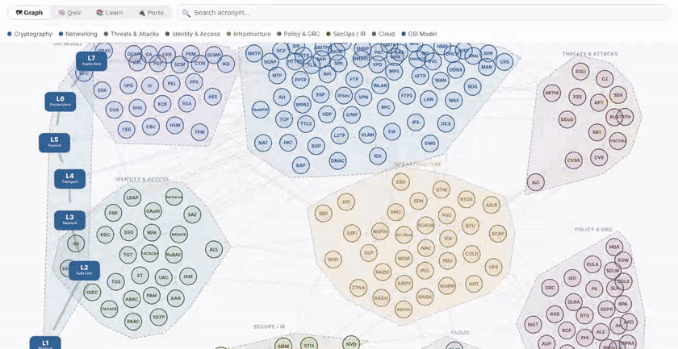
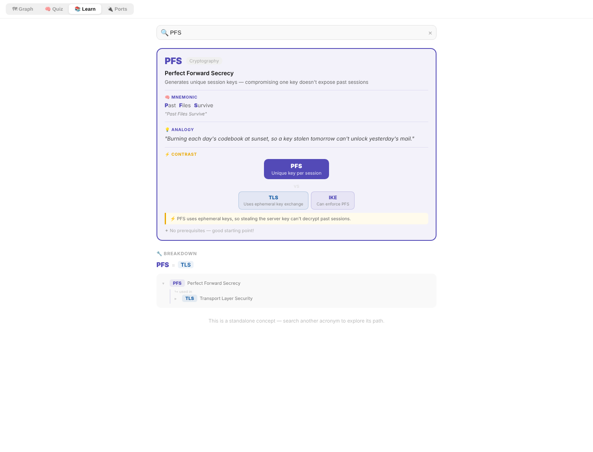
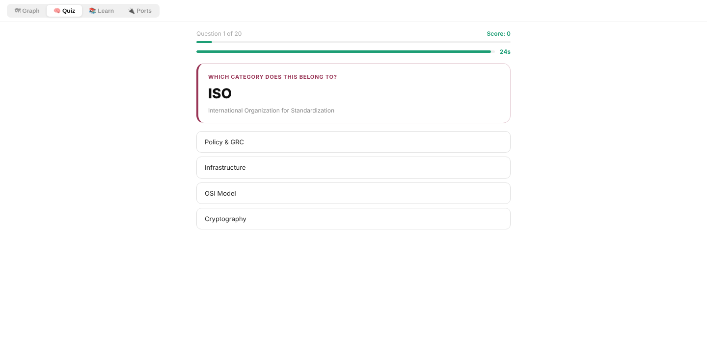
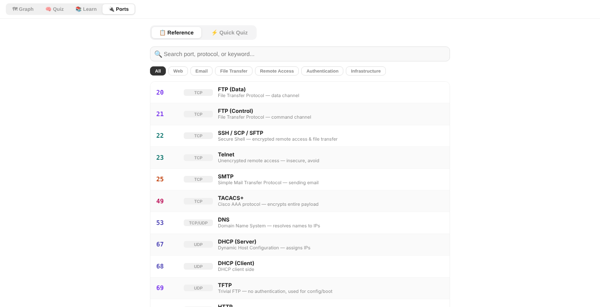

# Security+ Acronym Graph

An interactive map of **223 CompTIA Security+ (SY0-701) acronyms**. Each acronym is a node in a force-directed graph, grouped by domain and mapped to the OSI layers. Click any acronym to see how it connects to the others: what it relies on, what uses it, what it replaces. You can also study it with an analogy, a contrast and a mnemonic, quiz yourself, or look up ports.

**[▶ Live demo](https://IreneN-V.github.io/secplus-acronym-graph/)**



## Why I built it

I made this while preparing for Security+ (SY0-701), which I passed. The official acronym list runs to hundreds of entries, and memorizing it as a flat list didn't work for me. Acronyms only stuck once I could see the relationships, for example that **TGT → TGS → ST** is one Kerberos flow, or that **SLE × ARO = ALE**.

## Features

**Graph.** 223 acronyms in 9 domains: Cryptography, Networking, Threats & Attacks, Identity & Access, Infrastructure, Policy & GRC, SecOps / IR, Cloud and the OSI model. There are 347 labeled relationships ("relies on", "replaces", "mitigated by", "issues", …). You can search, drag and zoom, and clicking a node highlights its neighborhood.

**Learn.** Pick an acronym to get a study card:
- **Mnemonic:** a phrase built letter by letter from the acronym
- **Analogy:** an everyday comparison ("a valet key" for OAuth, "a theme park wristband" for Kerberos)
- **Contrast:** how it differs from the acronyms it is most often confused with
- **Learning path:** the concepts to learn first, and what the acronym unlocks next

**Quiz.** Timed questions filtered by domain, plus a **Risk Math** mode for SLE / ALE / ARO / EF calculations.

**Ports.** A searchable reference of the ports and protocols on the exam, plus a quick quiz.

| Learn card | Quiz | Ports |
|---|---|---|
|  |  |  |

## Security design decision: no API key in the browser

The first prototype generated analogies, contrasts and mnemonics live with the Claude API, calling it from the browser with an API key in `.env`. That works in a private sandbox, but in a static site any `REACT_APP_*` variable is **compiled into the public JavaScript bundle**, where anyone can read it with DevTools.

Two other options I considered:
- **Visitors bring their own key.** Safe, but most visitors would never see the feature.
- **A serverless proxy** that holds the key server-side. It works, but it needs rate limiting and spend caps, and it is still an open endpoint.

Instead I looked at the inputs. Every prompt depends **only on the selected acronym**: 223 acronyms × 3 content types = 669 fixed answers. So the content is generated ahead of time and shipped as static JSON:

- No secrets in the client, no backend, no running cost, nothing to abuse
- Instant results that work offline
- Each entry can be **reviewed and validated**, which matters for exam material

The source content lives in [`content/`](content/). [`scripts/validate-content.cjs`](scripts/validate-content.cjs) checks every entry:
- every mnemonic word starts with the matching letter of its acronym
- every contrast refers only to acronyms actually linked in the graph
- every text field stays within its length limit

Run it with `npm run validate-content`.

## Tech

- React 18 + **D3 force simulation** for the graph, built with Vite
- Static JSON content, with no runtime API calls
- Deployed to GitHub Pages through GitHub Actions

## Run locally

```bash
git clone https://github.com/IreneN-V/secplus-acronym-graph.git
cd secplus-acronym-graph
npm install
npm run dev
```

Production build: `npm run build` (output goes to `dist/`).

## Disclaimer

This is an independent study aid, not affiliated with CompTIA. Analogies and mnemonics are memory aids and simplify the concepts on purpose.
